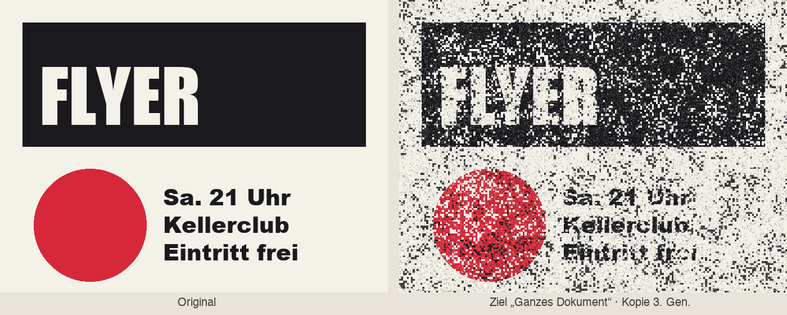

<p align="center">
  
</p>

<p align="center">
  <b>Druckerfehler, Toner-Rauschen und Kopierer-Look für Photoshop – auf einzelnen Ebenen oder als Overlay für das ganze Dokument.</b><br>
  <sub>Photoshop 2023 (24.2) oder neuer · UXP-Panel · aus der Familie von <a href="https://github.com/M0rgenst3rn/ms-distress">MS Distress</a></sub>
</p>

---

## Was ist MS Printer?

MS Printer ist ein Panel-Plugin für Adobe Photoshop. Es lässt digitale Grafiken aussehen wie
ausgedruckt, kopiert oder gefaxt. Dazu gehören Toner-Körnung, Streifen von der Druckertrommel,
Inkjet-Banding, Riso-Flecken, Raster, Fax-Linien und vieles mehr.

Alles bleibt **nicht-destruktiv**:

- Helle Aussetzer landen in einer Ebenenmaske
- Dunkler Toner liegt auf einer eigenen, geclippten Ebene
- Streu-Toner und Fehldruck-Versatz bekommen eigene Ebenen

Mit ⌘Z oder „Entfernen“ ist alles wieder weg.

<table>
<tr>
<td width="38%" valign="top"></td>
<td valign="top">

### Highlights

- **43 eingebaute Druckfehler** in 7 Gruppen: Laser, Kopierer, Inkjet, Riso, Raster, Fax & Bon, Digital & Papier
- **Eigene Scans laden**: PNG, JPG, TIF oder PSD. Sie werden dauerhaft als Kachel gespeichert
- **Zwei Druckfehler kombinieren**: Überblenden, Addieren oder Maskieren
- **Zwei Ziele**: ausgewählte Ebenen (Text, Formen, Smartobjekte) oder das **ganze Dokument** als Overlay-Ebene
- **Getrennte Regler** für Toner (dunkel), Aussetzer (hell) und Körnung
- **Streu-Toner** um die Form und **Fehldruck-Versatz** für den Riso- und Offset-Look
- **Live auf Canvas** mit aktivierbarer Vorschau, als *ein* Protokollschritt
- **14 Presets**: Fotokopie, Riso, Fax, Kassenbon, Nadeldrucker … plus eigene
- **Selbsttest**: prüft alle Funktionen automatisch gegen das echte Photoshop-Ergebnis (79 Prüfungen)

</td>
</tr>
</table>

## Die Druckfehler

Alle 43 Druckfehler sind prozedural, also mathematisch erzeugt. Darum sind sie in jeder Größe scharf und
nahtlos. Über **Random Seed** gibt es unendlich viele Varianten.

<p align="center"></p>

## Ganzes Dokument

Mit dem Ziel **„Ganzes Dokument“** legt MS Printer eine einzige Overlay-Ebene ganz oben ins Dokument.
Darin liegen Toner in der Toner-Farbe und Aussetzer in der Papierfarbe. So wirkt die ganze Gestaltung wie
einmal durch den Kopierer gelaufen.

<p align="center"></p>

## Die Regler

<p align="center"></p>

| Regler | Was er macht |
|---|---|
| **Scale / Winkel** | Größe und Richtung des Druckfehlers, zum Beispiel Streifen waagerecht statt senkrecht |
| **Korngröße** | Größe der einzelnen Körner in Pixeln |
| **Intensität** | Gesamtstärke, wirkt auf alles gleichzeitig |
| **Toner (dunkel)** | Anteil dunkler Toner-Flecken |
| **Aussetzer (hell)** | Anteil heller Stellen, an denen das Papier durchscheint |
| **Körnung** | Zusätzliches feines Pixelkorn, hell und dunkel |
| **Weichheit** | Harte Druckpunkte bis weicher Übergang |
| **Kantenrauheit** | Ausgefranste Außenkante |
| **Streu-Toner / Abstand** | Verirrte Tonerpunkte rund um die Form |
| **Toner-Farbe / Deckkraft / Mischmodus** | Farbe und Wirkung der Toner-Ebene (Multiplizieren, Linear nachbelichten …) |
| **Papierfarbe** | Farbe der Aussetzer im Dokument-Modus |
| **Fehldruck-Versatz** | Versetzte Kopie in einer zweiten Farbe (X, Y, Deckkraft) |
| **Verlauf** | Lässt den Effekt verlaufen, zum Beispiel wenn der Toner nach unten ausläuft |
| **Toner/Aussetzer tauschen** | Vertauscht dunkle und helle Bereiche |

Wie beim MS Distress werden die Druckfehler intern gleichverteilt. **„Toner 20 %“ bedeutet bei jedem Typ
ungefähr 20 % Fläche.** Wechselst du den Typ, bleibt die Stärke gleich.

## Installation

### macOS (empfohlen)

1. Repository herunterladen (**Code → Download ZIP**) und entpacken
2. Im Terminal im entpackten Ordner ausführen:
   ```bash
   bash install-mac.sh
   ```
3. Photoshop (neu) starten → **Fenster › Zusatzmodule (Plugins) › MS Printer**

### Alternative: UXP Developer Tool (macOS & Windows)

1. „UXP Developer Tools“ über die Creative-Cloud-App installieren
2. In Photoshop unter *Einstellungen › Zusatzmodule* den **Entwicklermodus** aktivieren
3. Im UXP Developer Tool **Add Plugin** wählen, dann `printer/manifest.json` → **Load**

## So benutzt du es

1. Unter **Ziel** „Ausgewählte Ebenen“ oder „Ganzes Dokument“ wählen
2. Einen Druckfehler anklicken und die Regler einstellen. Die Vorschau oben zeigt das Ergebnis sofort
3. **Druck anwenden** klicken, oder **Live** einschalten
4. Mit **Entfernen** sind Maske und Druck-Ebenen wieder weg

**Ebenen, die MS Printer anlegt** (Beispiel für eine Ebene „Logo“):

```
Logo · Streutoner      Punkte um die Form (Farbe der Ebene)
Logo · Toner           geclippt, Mischmodus wählbar
Logo                   mit Ebenenmaske (Aussetzer)
Logo · Versatz         versetzte Kopie, multipliziert
```

**Tipps**
- Eigene Scans: dunkle Bereiche werden zu Toner, helle zu Aussetzern. Mit „tauschen“ geht es umgekehrt
- **Prüfen** vergleicht den Canvas mit den aktuellen Einstellungen
- Den **Selbsttest** gibt es auch im Menü *Zusatzmodule › MS Printer › Selbsttest ausführen*

## Projektstruktur

```
printer/             Das Plugin (wird so in Photoshop geladen)
  manifest.json      Plugin-Beschreibung
  index.html         Panel-Oberfläche
  main.js            Photoshop-Anbindung (Ebenen, Masken, Live, Prüfen, Selbsttest)
  core.js            Druckfehler-Engine, reines JavaScript
install-mac.sh       Packt das Plugin (.ccx) und installiert es
tools/               Test-Renderer und Generator für die Bilder dieser README
docs/images/         Screenshots und Beispielbilder
```

```bash
node tools/render-test.js test.png      # alle Druckfehler ohne Photoshop rendern
python3 tools/make-showcase.py          # Bilder dieser README neu erzeugen (braucht Pillow)
```

---

<p align="center"><sub>MS Printer<br>
Entwickelt von Linus Leinberger</sub></p>
