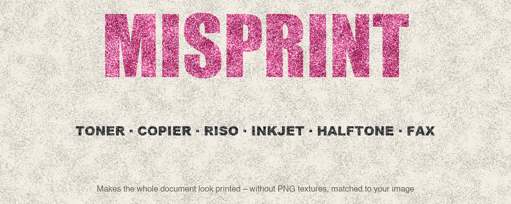
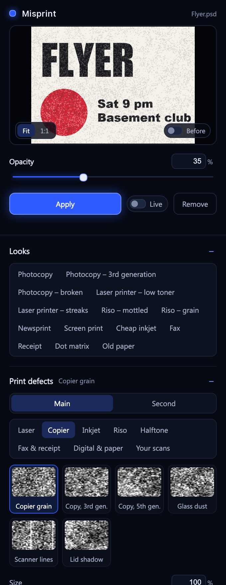
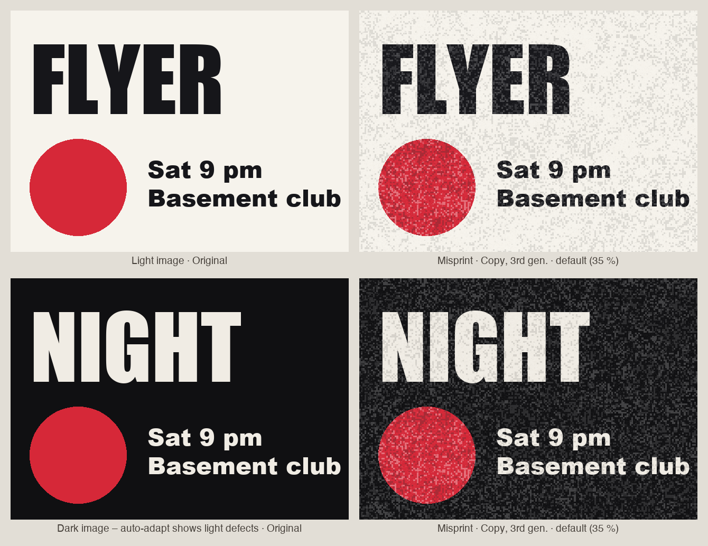
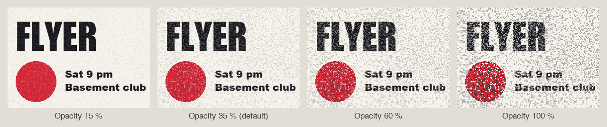
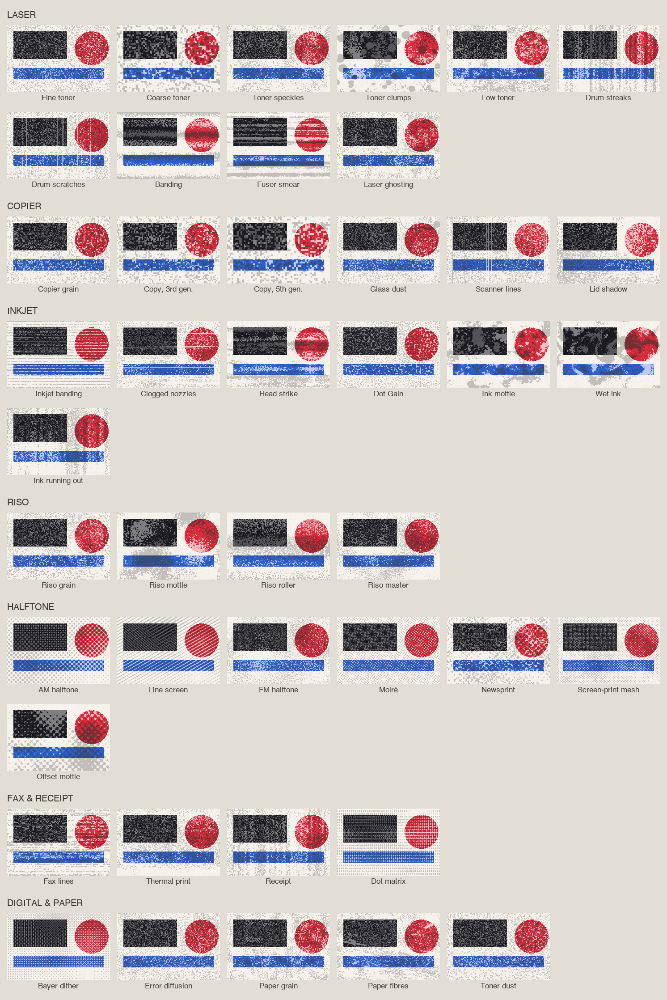
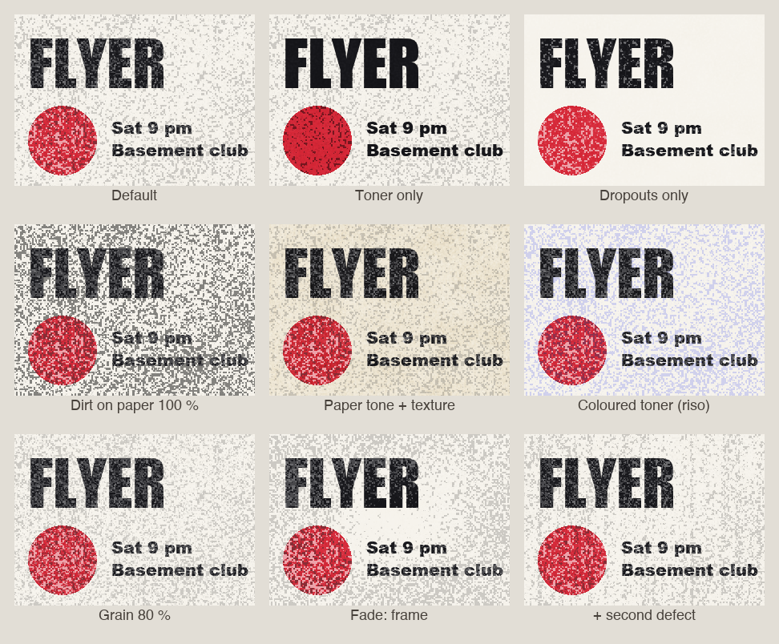

<p align="center">
  
</p>

<p align="center">
  <b>Makes your whole Photoshop document look printed, photocopied or faxed – without PNG textures.</b><br>
  <sub>Photoshop 2023 (24.2) or newer · UXP panel</sub><br>
  <sub>More tools by <b>Linus Leinberger</b> · <a href="https://github.com/M0rgenst3rn/afterglow">Afterglow</a> · <a href="https://github.com/M0rgenst3rn/asciiwave">Asciiwave</a> · <a href="https://github.com/M0rgenst3rn/gradient-library">Gradient Library</a> · <a href="https://github.com/M0rgenst3rn/gridwork">Gridwork</a> · <a href="https://github.com/M0rgenst3rn/grime">Grime</a> · <a href="https://github.com/M0rgenst3rn/headliner">Headliner</a> · <b>Misprint</b> · <a href="https://github.com/M0rgenst3rn/seamline">Seamline</a> · <a href="https://github.com/M0rgenst3rn/vhold">Vhold</a></sub>
</p>

---

## What is Misprint?

Digital graphics often look too clean and too perfect. **Misprint** gives them the look of real
print: toner spots, dropouts, paper texture and noise. Everything is computed procedurally, without any image
files.

With one click the plugin puts a group **"Misprint"** at the top of the document. It holds real texture
layers that you can then adjust in Photoshop as usual:

```
Misprint   (group, opacity 35 %)
├─ Dropouts         paper colour where toner is missing
├─ Toner            dark spots, Multiply
├─ Paper texture    Soft Light
└─ Paper tone       Multiply
```

<table>
<tr>
<td width="38%" valign="top"></td>
<td valign="top">

### Highlights

- **Always the whole document**: one group, real layers with blend modes
- **43 print defects** in 7 categories: laser, copier, inkjet, riso, halftone, fax & receipt, digital & paper
- **Adapts to your image**: light or dark, printed or paper
- **Opacity** at the top of the panel, a subtle 35 % by default
- **Preview** of the whole document or a 1:1 detail, plus **Live** in the document
- **A tidy panel**: defects sorted by category, collapsible sections, its own colour palette
- **Load your own scans**, combine two defects, **14 looks**
- **Self-test**: 84 checks against the real Photoshop result

</td>
</tr>
</table>

**Misprint looks at your document**:

- **On light areas** defects appear as toner spots and fine dirt on the paper.
- **On dark areas** they appear as light spots – missing toner and dust. So the look also shows on black images.
- **Dropouts** only appear where something is actually printed.

<p align="center"></p>

## Subtle by default

Real print defects are subtle. That's why the whole group starts at **35 % opacity**. Turn it up or down
right at the top of the panel under **Opacity**, or later on the group in Photoshop.

<p align="center"></p>

## 43 print defects

Every defect is generated procedurally, sharp and seamless at any resolution. **Seed** (Shuffle) gives
endless variants. Rendered at 75 % opacity for this overview:

<p align="center"></p>

Load your own scans with **"Load scan…"** as extra tiles. Two defects can be combined: blend, add or mask.

## The sliders

<p align="center"></p>

| Section | Slider | What it does |
|---|---|---|
| Top | **Opacity** | Opacity of the whole group, 35 % by default |
| Print defects | **Size** | Size of the defect |
| Toner | **Amount / Colour** | Dark spots |
| Dropouts | **Amount / Paper colour** | Places where the paper shows through |
| Paper | **Paper tone / Grain** | Tint of the paper, e.g. yellowed, and fine pixel grain |
| | **Adapt to document colours** | Light defects on dark areas (on by default) |
| Fine-tuning | **Angle / Grain size** | Direction and grain of the defect |
| Fine-tuning | **Toner: Opacity / Dirt on paper / Blend mode** | How much toner lands on unprinted areas |
| Fine-tuning | **Dropouts: Opacity / Blend mode** | Strength of the dropout layer |
| Fine-tuning | **Paper: Texture / Softness** | Paper fibre texture, hard or soft dots |
| Fine-tuning | **Fade: Amount / Direction** | Defects increase towards the edge, the bottom … |

The preview shows the whole document or a **1:1 detail**, so you see the real grain. With **Live**, changes
land in the document right away, combined into one history step.

## Looks

Photocopy · Photocopy 3rd generation · Photocopy broken · Laser printer low toner · Laser printer streaks ·
Riso mottled · Riso grain · Newsprint · Screen print · Cheap inkjet · Fax · Receipt · Dot matrix ·
Old paper, plus your own presets.

## Installation

### macOS (recommended)

1. Download the repository (**Code → Download ZIP**) and unzip it
2. Run this in Terminal inside the unzipped folder:
   ```bash
   bash install-mac.sh
   ```
3. (Re)start Photoshop → **Plugins › Misprint**

### Alternative: UXP Developer Tool (macOS & Windows)

1. Install "UXP Developer Tools" from the Creative Cloud app
2. In Photoshop, turn on **Developer Mode** under *Settings › Plugins*
3. In the UXP Developer Tool choose **Add Plugin**, then `printer/manifest.json` → **Load**

## How to use it

1. Open a document and start Misprint
2. Pick a defect or a look. The preview shows the result right away
3. Click **Apply**, or turn on **Live**
4. Fine-tune in the panel or directly on the group "Misprint" in Photoshop
5. **Remove** deletes the group again. Your artwork is never changed

**Tip:** the group always sits at the very top. It only takes new content you add later into account when you
click "Apply" again or Live is on.

## Project structure

```
printer/             The plugin (loaded into Photoshop as is)
  manifest.json      Plugin description
  index.html         Panel UI
  ui.js/.css      Shared controls and design
  main.js            Photoshop side (group, preview, Live, verify, self-test)
  core.js            Print defect engine and layer simulation, plain JavaScript
install-mac.sh       Packs the plugin (.ccx) and installs it
tools/               Test renderer, README image generator, browser preview of the panel
docs/images/         Example images
```

```bash
node tools/render-test.js test.png      # render every defect without Photoshop
python3 tools/make-showcase.py          # rebuild the images of this README (needs Pillow)
```

In the panel, **Self-test** automatically checks 84 cases against the real Photoshop result.

## Found a bug? Got an idea?

Get in touch! The easiest way is **[Issues](https://github.com/M0rgenst3rn/misprint/issues)** here on GitHub:
click **New issue** and briefly describe what happened. Your Photoshop version, operating system and a
screenshot help a lot. All you need is a free GitHub account. Suggestions and feature requests are just as
welcome.

## License

[MIT with the Commons Clause](LICENSE): the plugin is free. You may use it for any work, including paid
client work, and you may read, change and share the code.
You may not sell the plugin or a version of it (changed or not), or charge for a product or service whose
value comes mainly from it.
Everything you create with it (designs, images, prints) is yours, and you may sell it.
The license notice stays in copies.

Adobe and Photoshop are trademarks of Adobe Inc. This project is independent and not affiliated with Adobe.

---

<p align="center"><sub>Misprint<br>
Made by Linus Leinberger · <a href="https://www.instagram.com/linusleinberger">Instagram @linusleinberger</a></sub></p>
