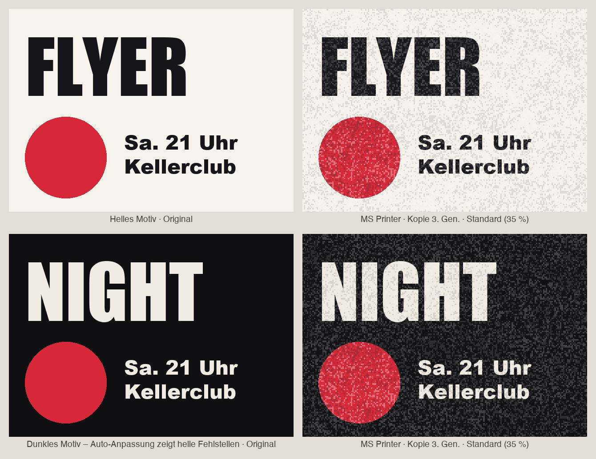
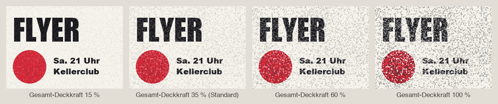
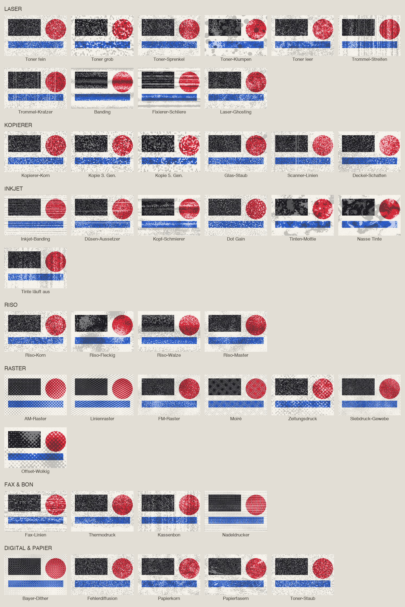
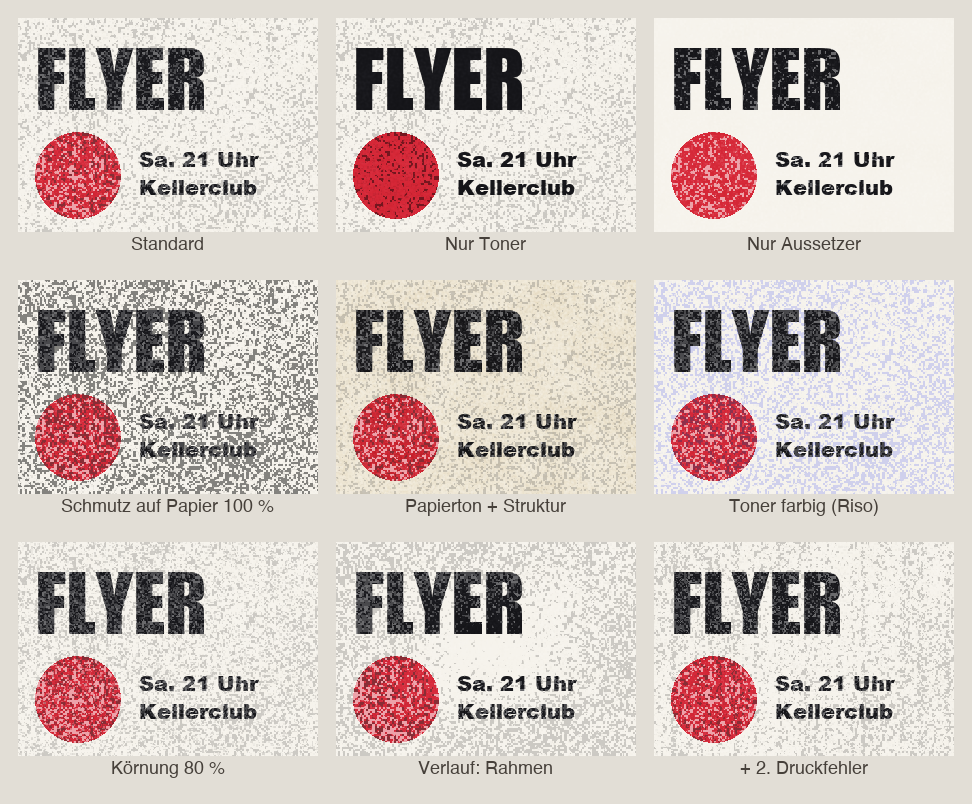

<p align="center">
  
</p>

<p align="center">
  <b>Lässt dein ganzes Photoshop-Dokument aussehen wie gedruckt, kopiert oder gefaxt – ohne PNG-Texturen.</b><br>
  <sub>Photoshop 2023 (24.2) oder neuer · UXP-Panel · aus der Familie von <a href="https://github.com/M0rgenst3rn/ms-distress">MS Distress</a></sub>
</p>

---

## Was ist MS Printer?

Digitale Grafiken wirken oft zu sauber und zu perfekt. **MS Printer** gibt ihnen den Look von echtem Druck:
Toner-Flecken, Aussetzer, Papierstruktur und Rauschen. Alles wird prozedural berechnet, ganz ohne Bilddateien.

Mit einem Klick legt das Plugin oben ins Dokument eine Gruppe **„MS Printer“**. Darin liegen echte
Textur-Ebenen, die du danach ganz normal in Photoshop anpassen kannst:

```
MS Printer   (Gruppe, Gesamt-Deckkraft 35 %)
├─ Aussetzer        Papierfarbe, dort wo Toner fehlt
├─ Toner            dunkle Flecken, Multiplizieren
├─ Papierstruktur   Weiches Licht
└─ Papierton        Multiplizieren
```

<table>
<tr>
<td width="38%" valign="top"></td>
<td valign="top">

### Highlights

- **Immer das ganze Dokument**: eine Gruppe, echte Ebenen mit Mischmodi
- **43 Druckfehler** in 7 Gruppen: Laser, Kopierer, Inkjet, Riso, Raster, Fax & Bon, Digital & Papier
- **Passt sich deinem Motiv an**: hell oder dunkel, bedruckt oder Papier
- **Gesamt-Deckkraft** oben im Panel, Standard dezente 35 %
- **Vorschau** des ganzen Dokuments oder im Detail 1:1, dazu **Live** im Dokument
- **Eigene Scans laden**, zwei Druckfehler kombinieren, **14 Presets**
- **Selbsttest**: 84 Prüfungen gegen das echte Photoshop-Ergebnis

</td>
</tr>
</table>

**MS Printer schaut sich dein Dokument an**:

- **Auf hellen Flächen** erscheinen Fehler als Toner-Flecken und feiner Schmutz auf dem Papier.
- **Auf dunklen Flächen** erscheinen sie als helle Fehlstellen, also fehlender Toner und Staub. So ist der Look auch auf schwarzen Motiven sichtbar.
- **Aussetzer** entstehen nur dort, wo tatsächlich etwas gedruckt ist.

<p align="center"></p>

## Dezent als Standard

Echte Druckfehler sind subtil. Darum startet die ganze Gruppe mit **35 % Deckkraft**. Mehr oder weniger
stellst du direkt oben im Panel unter **Gesamt-Deckkraft** ein, oder später an der Gruppe in Photoshop.

<p align="center"></p>

## 43 Druckfehler

Alle Druckfehler sind prozedural erzeugt, in jeder Auflösung scharf und nahtlos. Über **Random Seed**
gibt es unendlich viele Varianten. Für die Übersicht hier mit 75 % Deckkraft gerendert:

<p align="center"></p>

Eigene Scans lädst du über **„Scan laden…“** als
zusätzliche Kacheln. Zwei Druckfehler lassen sich kombinieren: überblenden, addieren oder maskieren.

## Die Regler

<p align="center"></p>

| Bereich | Regler | Was er macht |
|---|---|---|
| Oben | **Gesamt-Deckkraft** | Deckkraft der ganzen Gruppe, Standard 35 % |
| Druckfehler | **Scale / Winkel / Korngröße** | Größe, Richtung und Korn des Druckfehlers |
| Toner | **Menge / Deckkraft / Farbe / Mischmodus** | Dunkle Flecken |
| Toner | **Schmutz auf Papier** | Wie viel Toner auf unbedruckten Flächen landet |
| Aussetzer | **Menge / Deckkraft / Papierfarbe / Mischmodus** | Stellen, an denen Papier durchscheint |
| Papier | **Struktur / Papierton** | Papierfaser-Struktur und Färbung, zum Beispiel vergilbt |
| Struktur | **Körnung / Weichheit** | Feines Pixelkorn, harte oder weiche Druckpunkte |
| Verlauf | **Stärke / Stil** | Fehler nehmen zum Rand, nach unten … zu |
| | **An Dokumentfarben anpassen** | Helle Fehlstellen auf dunklen Flächen (Standard: an) |

Die Vorschau zeigt das ganze Dokument oder einen **Ausschnitt in 1:1**, damit du das echte Korn siehst.
Mit **Live** landen Änderungen sofort im Dokument, zusammengefasst als ein Protokollschritt.

## Presets

Fotokopie · Fotokopie 3. Generation · Fotokopie kaputt · Laserdrucker Toner leer · Laserdrucker Streifen ·
Riso fleckig · Riso Korn · Zeitungsdruck · Siebdruck · Inkjet billig · Fax · Kassenbon · Nadeldrucker ·
Altes Papier, dazu eigene Presets zum Speichern.

## Installation

### macOS (empfohlen)

1. Repository herunterladen (**Code → Download ZIP**) und entpacken
2. Im Terminal im entpackten Ordner ausführen:
   ```bash
   bash install-mac.sh
   ```
3. Photoshop (neu) starten → **Fenster › Zusatzmodule (Plugins) › MS Printer**

### Alternative: UXP Developer Tool (macOS & Windows)

1. „UXP Developer Tools“ über die Creative-Cloud-App installieren
2. In Photoshop unter *Einstellungen › Zusatzmodule* den **Entwicklermodus** aktivieren
3. Im UXP Developer Tool **Add Plugin** wählen, dann `printer/manifest.json` → **Load**

## So benutzt du es

1. Dokument öffnen und MS Printer starten
2. Einen Druckfehler oder ein Preset wählen. Die Vorschau zeigt das Ergebnis sofort
3. **Druck-Look anwenden** klicken, oder **Live** einschalten
4. Feinschliff wahlweise im Panel oder direkt an der Gruppe „MS Printer“ in Photoshop
5. **Entfernen** löscht die Gruppe wieder. Dein Artwork wird nie verändert

**Tipp:** Die Gruppe liegt immer ganz oben. Neue Inhalte, die du später hinzufügst, berücksichtigt sie
erst, wenn du erneut auf „Anwenden“ klickst oder Live eingeschaltet ist.

## Projektstruktur

```
printer/             Das Plugin (wird so in Photoshop geladen)
  manifest.json      Plugin-Beschreibung
  index.html         Panel-Oberfläche
  main.js            Photoshop-Anbindung (Gruppe, Vorschau, Live, Prüfen, Selbsttest)
  core.js            Druckfehler-Engine und Ebenen-Simulation, reines JavaScript
install-mac.sh       Packt das Plugin (.ccx) und installiert es
tools/               Test-Renderer und Generator für die Bilder dieser README
docs/images/         Beispielbilder
```

```bash
node tools/render-test.js test.png      # alle Druckfehler ohne Photoshop rendern
python3 tools/make-showcase.py          # Bilder dieser README neu erzeugen (braucht Pillow)
```

Im Panel prüft **Selbsttest** 84 Fälle automatisch gegen das echte Photoshop-Ergebnis.

## Fehler gefunden? Ideen?

Melde dich gern! Am einfachsten über **[Issues](https://github.com/M0rgenst3rn/ms-printer/issues)** hier auf GitHub:
**New issue** klicken und kurz beschreiben, was passiert ist. Hilfreich sind Photoshop-Version, Betriebssystem
und gern ein Screenshot. Dafür brauchst du nur ein kostenloses GitHub-Konto. Verbesserungsvorschläge und
Wünsche für neue Funktionen sind genauso willkommen.

## Lizenz

[MIT](LICENSE): Du darfst den Code frei ansehen, verändern, weitergeben und auch kommerziell nutzen.
Einzige Bedingung: Der Lizenzhinweis bleibt in Kopien enthalten.

---

<p align="center"><sub>MS Printer<br>
Entwickelt von Linus Leinberger</sub></p>
